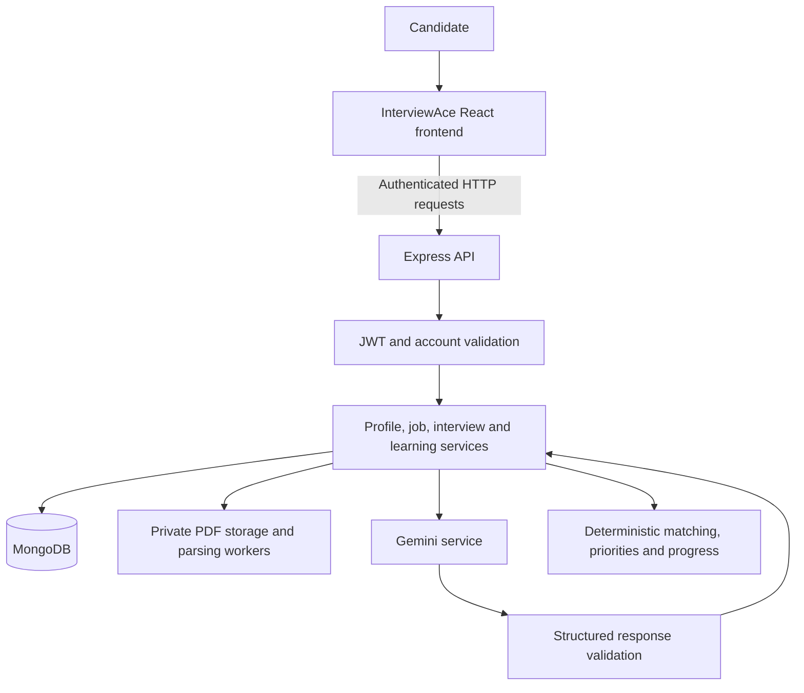
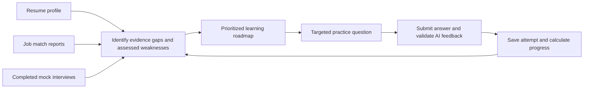
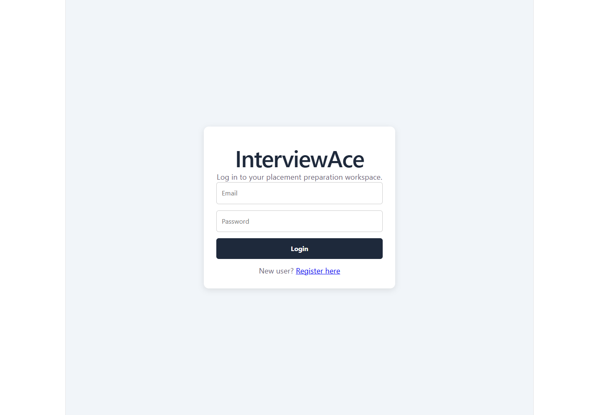
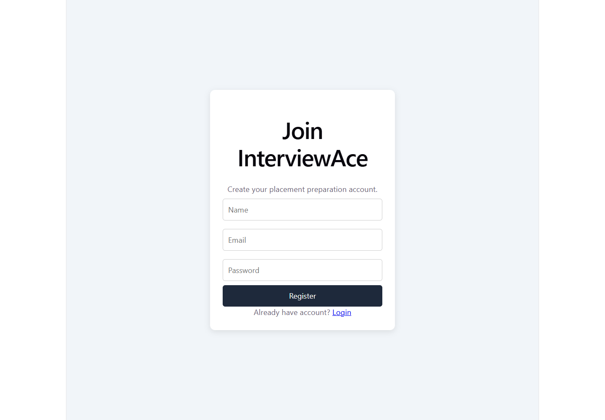
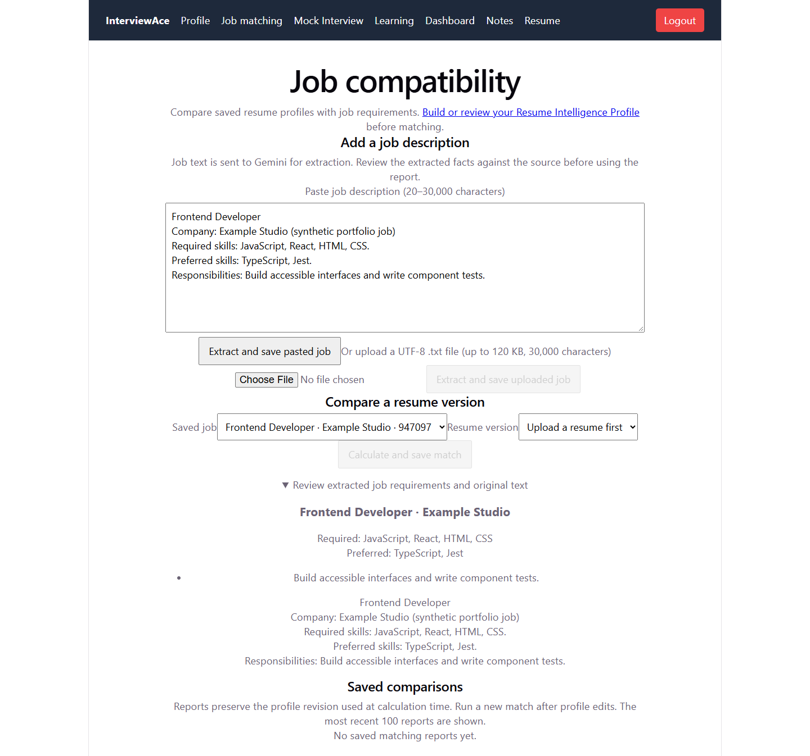

# InterviewAce

InterviewAce is an AI-assisted placement preparation application built with MongoDB, Express, React and Node.js. It connects resume evidence, job requirements, mock interview feedback and targeted practice in one preparation workflow.

## Problem Statement and Objectives

Candidates often prepare with disconnected resume tools, generic interview questions and untracked study plans. InterviewAce aims to help candidates:

- Review and correct structured resume information against its source.
- Understand explicit gaps between their resume evidence and a target job.
- Practice technical, behavioral and project discussions with structured feedback.
- Prioritize learning and track assessed improvement across repeated attempts.

AI feedback and compatibility scores are preparation guidance, not verified employer ATS results, hiring predictions or independently certified skill assessments.

## Key features

| Implementation phase | Features |
| --- | --- |
| Phase 1: foundation and security | Registration/login, JWT authentication, account/session validation, private PDF resume uploads, resume analysis, ATS feedback, generated interview questions and private notes with CRUD operations. |
| Phase 2: resume intelligence | Saved candidate profiles per resume version; education, experience, projects, achievements and categorized skills; source evidence; editable facts and review decisions; deterministic profile presentation scoring. |
| Phase 3: job intelligence | Pasted or uploaded text job descriptions, structured requirement extraction, required/preferred skill comparisons, evidence-based compatibility scores and saved match reports. |
| Phase 4: mock interviews | Technical, HR, Project-Based and Mixed sessions; selectable difficulty; sequential answers; rubric feedback; resumable sessions and completed interview reports. |
| Phase 5: adaptive learning | Resume/job target selection, prioritized Beginner/Intermediate/Advanced tasks, conceptual/technical/scenario practice, saved answers and feedback, skill progress, revision recommendations and retained task/attempt history. |

The original dashboard's free-form analysis, ATS feedback and question results remain browser-state outputs. Candidate profiles, job matches, mock interviews and learning records use MongoDB persistence.

## Technology stack

| Layer | Technologies |
| --- | --- |
| Frontend | React, React Router, Vite, Axios, CSS, React Icons |
| Backend | Node.js, Express, Mongoose, Multer, pdf-parse |
| Database and files | MongoDB (local or Atlas), private server-side PDF storage |
| AI | Google Gemini through the existing `@google/generative-ai` service |
| Authentication | JSON Web Tokens, bcrypt password hashing |
| Verification | Node.js test runner, React server-rendering checks, ESLint, Vite production build |

## System architecture



The frontend shares an authenticated API client and session guards. Backend routes apply authentication and owner-scoped access before source data or saved resources are used. Services coordinate extraction, validation, persistence and scoring; schema modules validate structured AI results.

## Repository structure

```text
InterviewAce/
├── backend/
│   ├── app.js                 # Express middleware and API registration
│   ├── server.js              # Environment validation and database startup
│   ├── config/                # Environment, storage and upload policies
│   ├── controllers/           # Resume/profile request handling
│   ├── middleware/            # Authentication, uploads, errors and rate limits
│   ├── models/                # Mongoose models
│   ├── routes/                # Authentication, notes, resume and feature APIs
│   ├── schemas/               # Structured response and input validation
│   ├── services/              # Gemini and preparation business logic
│   ├── workers/               # Isolated PDF validation/text extraction
│   ├── tests/                 # Service, schema and HTTP regression tests
│   └── uploads/               # Private runtime PDFs; new uploads ignored by Git
├── frontend/
│   ├── public/                # Browser assets, including the InterviewAce favicon
│   ├── src/
│   │   ├── components/        # Navigation, reports, forms and progress views
│   │   ├── context/           # Authentication state
│   │   ├── lib/               # API clients, session and feature helpers
│   │   └── pages/             # Login, registration and preparation dashboards
│   └── tests/                 # Client, session and rendered-component tests
├── docs/                      # Phase implementation and verification notes
├── InterviewAce Photos/       # Historical interface screenshots
├── AGENTS.md                  # Project naming rule for future agent work
└── README.md
```

The tree uses the product name for illustration; an existing local checkout folder does not need to be renamed. Backend and frontend dependencies are installed separately; the root package is not an npm workspace or application launcher.

## Database models and relationships

| Model | Purpose and relationships |
| --- | --- |
| `User` | Account identity, password hash, disabled status and session version. |
| `Resume` | Owned upload metadata, content hash and cached extracted text; PDFs remain on disk. |
| `Note` | Private title/content records linked to an account by `userId`. |
| `CandidateProfile` | One profile per owner/resume; structured facts, evidence, corrections, revision and extraction state. |
| `JobDescription` | Owned source text and extracted required/preferred skills; deduplicated by source hash. |
| `MatchReport` | Saved comparison linked to a resume, job, profile revision and matching algorithm version. |
| `InterviewSession` | Owned resume/job context snapshot, configuration, questions, answers, evaluations and session progress. |
| `LearningRoadmap` | One preparation target per owner/resume/optional job, with refreshed recommendation evidence. |
| `LearningTask` | Stable topic/level task within a roadmap, priority, completion status and revision guidance. |
| `PracticeAttempt` | Practice request, question, immutable submitted answer, feedback and timing linked to a task and roadmap. |

Each private resource is scoped by `userId`. References describe application relationships; MongoDB does not enforce relational foreign keys. Unique compound indexes support profile/target/task deduplication and request idempotency. Legacy `Interview` and `Report` model definitions are retained for compatibility; current mock interview and learning flows use the models above.

## AI integration and preparation workflow



Gemini extracts candidate/job information, generates interview/practice prompts and evaluates submitted answers. Structured flows request JSON schemas and validate types, bounds, expected fields and relevant source constraints before accepting results. Candidate facts must remain grounded in saved evidence or explicit user corrections. Source documents and answers are treated as untrusted data; prompt instructions alone are not a security boundary.

Job matching and learning priorities are calculated by application code. Required job skills take priority over optional skills; recurring weaknesses and declining performance prompt additional attention. Stable normalized topic/level task keys avoid unnecessary duplicates. Refreshes retain completed tasks and historical attempts.

Task completion measures effort, not mastery. Recent skill performance averages the latest three evaluated answers; trends compare that average with the preceding three. Unassessed skills have no assessment score. Provider failures do not create learning credit. Leases, immutable saved answers and request keys support safe retries and concurrent provider operations.

## Authentication and security

- Passwords are hashed with bcrypt. New registration accepts at least eight characters and at most 72 bytes.
- Seven-day Bearer JWTs are checked alongside current account availability and `sessionVersion`; disabled/deleted accounts and revoked sessions are rejected.
- Owner-scoped queries protect notes, uploads, profiles, jobs, reports, sessions, roadmaps, tasks and attempts. Clients cannot select another resource's owner.
- Frontend session synchronization, cancellation and stale-response guards help prevent data from crossing account changes. Tokens are browser-local; XSS prevention remains important.
- PDF uploads have an inclusive 5 MB limit, extension/MIME and structural validation, opaque filenames and bounded processing. Uploaded PDFs are not served through a public static directory; downloads require authentication and ownership.
- Request validation, restricted CORS, security headers, rate guards and safe error responses reduce common misuse. Rate limits are process-local rather than distributed quotas.
- Real environment files, dependencies and generated output are ignored. Example configuration contains non-secret local defaults and replacement placeholders.

Three resume PDFs are already tracked under `backend/uploads/` from earlier work. Ignore rules cannot remove tracked files or their history. They are preserved pending an explicit privacy review; do not treat the repository as free of personal documents.

## Installation and local setup

Prerequisites: Git, Node.js 24 (used for local verification), npm, a reachable MongoDB instance and a Gemini API key with access to the configured model. Check the current provider account's model access and quotas before using AI features.

### 1. Get the code and install dependencies

```powershell
git clone https://github.com/dapinderbhullar/InterviewAce-.git InterviewAce
cd InterviewAce
npm ci --prefix backend
npm ci --prefix frontend
```

The existing remote repository slug has a trailing hyphen. It is preserved intentionally; the project identity is **InterviewAce**. For an existing checkout, keep its location and use the commands from its root.

### 2. Configure the environment

Copy `backend/.env.example` to `backend/.env` only if a local environment file does not already exist. Replace the JWT and Gemini placeholders; do not overwrite existing credentials. A local MongoDB database can use the example URI. For Atlas, supply your own connection URI and network access settings privately.

```powershell
# Run only when backend/.env does not already exist:
Copy-Item backend/.env.example backend/.env
# Generate a JWT secret locally, then put the value in backend/.env:
node -e "console.log(require('node:crypto').randomBytes(48).toString('hex'))"
```

| Variable | Location | Configuration |
| --- | --- | --- |
| `MONGO_URI` | `backend/.env` | Required MongoDB URI; example: `mongodb://127.0.0.1:27017/interviewace`. |
| `JWT_SECRET` | `backend/.env` | Required random secret. Placeholder values are rejected; production requires at least 32 bytes and sufficient character diversity. |
| `GEMINI_API_KEY` | `backend/.env` | Required private provider key; never expose it through a `VITE_` variable. |
| `GEMINI_MODEL` | `backend/.env` | Optional; defaults to `gemini-2.5-flash` in the service. |
| `PORT` | `backend/.env` | Optional; defaults to `5000`. |
| `FRONTEND_ORIGIN` | `backend/.env` | Exact allowed origin(s), comma-separated. Local default: `http://localhost:5173`. Production requires explicit public HTTPS origins. |
| `NODE_ENV` | Backend process environment | Set to `production` for production environment checks; unset for local development. |
| `VITE_API_BASE_URL` | Optional `frontend/.env` | API base URL including `/api`. Omit for the development proxy; see `frontend/.env.example`. |

### 3. Start the backend and frontend

```powershell
# Terminal 1, repository root:
npm run dev --prefix backend
# Or run without the development watcher:
npm start --prefix backend
```

```powershell
# Terminal 2, repository root:
npm run dev --prefix frontend
```

Open the frontend at `http://localhost:5173` (or the URL Vite prints). The backend listens on port `5000` by default and connects to MongoDB before accepting requests. `GET /health/ready` reports database readiness. The Vite development proxy forwards `/api` to `http://localhost:5000`; if the backend port changes, update that proxy or configure `VITE_API_BASE_URL`. If Vite selects a different port, allow its exact origin in the backend configuration.

Register, log in, upload a text-based PDF, build/review the profile at `/profile`, compare a job at `/jobs`, complete a session at `/interviews`, then open `/learning`. `/dashboard` retains free-form resume AI tools; `/notes` manages private preparation notes. Scanned image-only resumes require OCR, which is not implemented.

## Commands and testing

Run these commands from the repository root:

```powershell
npm test --prefix backend
npm test --prefix frontend
npm run lint --prefix frontend
npm run build --prefix frontend
git diff --check
```

Backend tests exercise schemas, deterministic scoring, ownership, real HTTP routing, provider failures, duplicate requests, leases and history preservation with injected repositories/providers. Frontend tests cover API payloads, session behavior and server-rendered components. HTTP tests need permission to connect to a temporary loopback server. They do not require live MongoDB or Gemini access and do not establish live provider quality or full browser end-to-end behavior.

The production frontend output is `frontend/dist/`. `npm run preview --prefix frontend` previews that bundle locally; it is not a production hosting setup. Deployment still requires HTTPS, SPA fallback routing, private file storage permissions, a reachable database and an `/api` reverse proxy or explicit frontend API base URL.

## Application Screenshots

Captured from the running InterviewAce application on 3 November 2026 with Playwright and Chrome at a 1440 × 1000 desktop viewport. Full-page captures retain important content below the fold. The sample job is synthetic input; its extracted requirements are actual Gemini output saved to MongoDB.

### Authentication

Current login and registration screens, captured without account credentials.





### Phase 3 — Job Matching: requirement extraction

A real Gemini extraction separates required and preferred skills from the sample job description. The saved job was verified again after a browser reload. This image demonstrates extraction, not a completed resume match.



### Remaining phase coverage

| Feature | Current capture status |
| --- | --- |
| Phase 1 — Dashboard and navigation | Authenticated dashboard verified; populated dashboard capture pending. |
| Phase 2 — Resume Intelligence | Protected page verified; synthetic PDF upload, extraction, editing, score and version captures pending. |
| Phase 3 — Completed job matches | Job extraction captured; resume comparisons and saved match reports pending. |
| Phase 4 — Mock Interviews | Protected page verified; completed sessions, feedback and reports pending. |
| Phase 5 — Adaptive Learning | Protected page verified; assessed practice, roadmap and progress captures pending. |

These remaining workflows have not been exercised end to end in the runtime smoke test. No fabricated results or empty-state screenshots are presented as completed AI outputs. See [local runtime verification](docs/LOCAL_RUNTIME_VERIFICATION.md) for checks, limitations and the repeatable browser script.

Existing images under [InterviewAce Photos](InterviewAce%20Photos/) are retained as historical assets and predate the current interface.

## Documentation

- [Security foundation and compatibility](docs/FOUNDATION.md)
- [Security remediation](docs/PHASE_1_6.md)
- [Resume intelligence](docs/PHASE_2.md)
- [Job intelligence and matching](docs/PHASE_3.md)
- [Mock interviews](docs/PHASE_4.md)
- [Adaptive learning](docs/phase-5-learning.md)

Phase documents record their own implementation scope and historical verification results. This README describes the combined application; earlier statements about features excluded from a particular phase do not mean those features are absent today.

## Future improvements

Potential next steps include database-backed integration tests, full browser workflow coverage, controlled live AI evaluation, accessibility reviews, pagination for longer histories, private object storage, distributed rate limits and durable job queues, and stronger observability and deployment automation. OCR and deeper assessment calibration would require separate implementation and validation. These are proposals, not current capabilities.

## Project identity and repository

The official project name is **InterviewAce**, without a product version suffix or a space between its words. Use that spelling in UI copy, documentation, screenshots, GitHub descriptions and release information. Lowercase npm identifiers, existing database names, API routes and historical Git URLs are technical identifiers rather than alternative product names.

Repository: [InterviewAce on GitHub](https://github.com/dapinderbhullar/InterviewAce-).

Suggested GitHub About description: **InterviewAce — a MERN application for resume intelligence, job matching, mock interviews and adaptive learning with Google Gemini.** Repository settings and publishing actions are managed separately from local documentation.

Author: Dapinder Bhullar.
